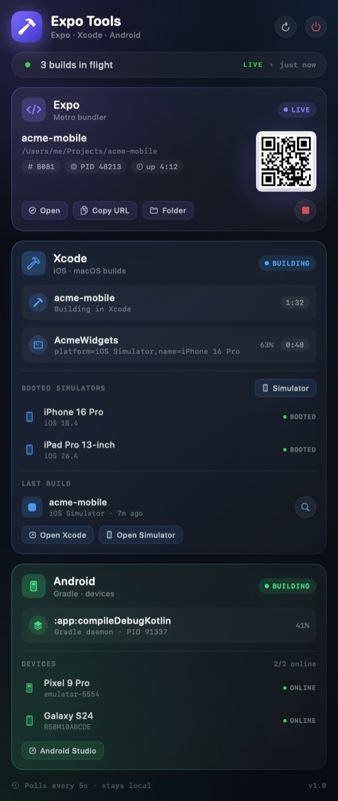

# Expo Tools

A native macOS menu bar app that watches your Expo, Xcode, and Android builds and puts everything one click away. No dock icon, no Electron, no accounts — just a hammer in the menu bar.



## What it does

The panel refreshes every 5 seconds and shows:

**Expo / Metro**
- Whether a Metro dev server is running, from `ps` + `lsof`
- Project name/path, port, PID and uptime
- Live reachability check against `http://127.0.0.1:<port>/status`
- LAN dev URL (`exp://192.168.x.x:8081`) with a scannable Expo Go QR code
- Open in browser, copy URL, reveal project folder, stop Metro

**Xcode**
- Command-line builds detected from `xcodebuild`, including scheme and destination
- Builds started from the Xcode UI, detected via recent `.xcactivitylog` activity
- Booted simulators from `xcrun simctl`
- The most recent `.app` in DerivedData, with platform and build age
- Open Xcode / open Simulator / reveal the built app

**Android**
- Gradle builds detected from daemon logs, wrapper processes, and busy daemons
- The latest Gradle task (`:app:compileDebugKotlin`, etc.) and CPU usage
- `adb devices` list for emulators and physical devices, with online/offline state
- Open Android Studio

Everything is read locally. The only network request is the Metro status probe on localhost.

## Requirements

- macOS 14 or newer
- Xcode command line tools (Swift 5.9+)
- [XcodeGen](https://github.com/yonaskolb/XcodeGen): `brew install xcodegen`
- Optional: Android SDK with `platform-tools` for device detection

## Run it

```sh
./scripts/run.sh
```

This generates the Xcode project, builds `dist/ExpoTools.app`, replaces any running copy, and launches it. Look for the hammer icon in the menu bar — there is intentionally no Dock icon.

For an iterative debug build:

```sh
./scripts/build.sh Debug
open dist/ExpoTools.app
```

The app is ad-hoc signed for local use. To keep it around, drag `dist/ExpoTools.app` into `/Applications` and add it under System Settings → General → Login Items.

## Command line utilities

Built into the app binary:

```sh
# Print a single detection pass (useful for debugging)
./dist/ExpoTools.app/Contents/MacOS/ExpoTools --dump

# Render the dashboard with sample data to a PNG
./dist/ExpoTools.app/Contents/MacOS/ExpoTools --render /tmp/dashboard.png
```

`--dump` example output:

```text
Expo / Metro
  • acme-mobile  pid=48213  port=8081  responding=true
    path: /Users/me/Projects/acme-mobile
    dev URL: exp://192.168.1.24:8081

Xcode
  • app running: true
  • build [xcode] acme-mobile — Building in Xcode (1:32)
  • simulator iPhone 16 Pro (iOS 18.4)
  • last build acme-mobile — iOS Simulator — .../acme-mobile.app

Android
  • Android Studio running: true
  • build :app:compileDebugKotlin — Gradle daemon · PID 91337
  • device Pixel 9 Pro [emulator-5554] Online
```

## How detection works

| Signal | Source |
| --- | --- |
| Expo process + project | `ps`, `lsof -d cwd` |
| Metro port + status | `lsof -iTCP -sTCP:LISTEN`, `GET /status` |
| Expo Go link | LAN IPv4 address + Metro port |
| Xcode CLI builds | `xcodebuild` process command line |
| Xcode UI builds | newest `Logs/Build/*.xcactivitylog` modified in the last 25s |
| Simulators | `xcrun simctl list devices booted --json` |
| Recent iOS build | newest `.app` under `DerivedData/*/Build/Products` |
| Android builds | `~/.gradle/daemon/*/daemon-*.out.log`, Gradle wrapper/client processes |
| Android devices | `adb devices -l` (SDK is auto-discovered) |

The scanning runs entirely off the main thread; the UI updates on a 5-second timer.

## Project layout

```text
project.yml                     XcodeGen spec (source of truth)
ExpoTools/
  App/
    ExpoToolsApp.swift          MenuBarExtra entry point
    DashboardView.swift         Dashboard + platform cards
    Components.swift            Cards, chips, rows, QR view
    PreviewRenderer.swift       `--render` mode + demo data
  Models/
    Models.swift                Sendable snapshot types
    Diagnostics.swift           `--dump` mode
  Services/
    SystemMonitor.swift         Process / DerivedData / adb / Gradle scanning
    MonitorStore.swift          Timer + published snapshot
    Shell.swift                 Timeout-aware process runner
    Actions.swift               Open/copy/reveal/stop actions + QR generation
  Assets.xcassets               App icon (generated)
scripts/
  build.sh                      xcodegen + xcodebuild + ad-hoc sign
  run.sh                        build + relaunch
  make-icon.swift               Regenerate the 1024px app icon
```

## Notes and limitations

- All build detection is heuristic. Xcode UI builds are only visible for projects that write activity logs (normal Xcode projects do).
- Stopping Metro sends `SIGINT` and only works for processes owned by your user.
- The app is not sandboxed, because it needs to inspect other processes and run developer tools. It makes no outbound connections.
- Ad-hoc signing means the app is fine on the machine that built it; distributing it to another Mac requires proper signing/notarization.
- Android device detection needs `adb` either on `PATH`, under `ANDROID_HOME`/`ANDROID_SDK_ROOT`, or in `~/Library/Android/sdk`.

## Development

`project.yml` is the source of truth. Run `xcodegen generate` after changing it. The app icon is checked in as an asset catalog and can be regenerated with:

```sh
swift scripts/make-icon.swift .build/icon/icon-1024.png
# then resize with sips into ExpoTools/Assets.xcassets/AppIcon.appiconset
```
